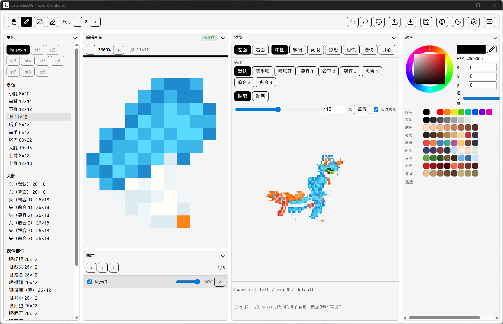
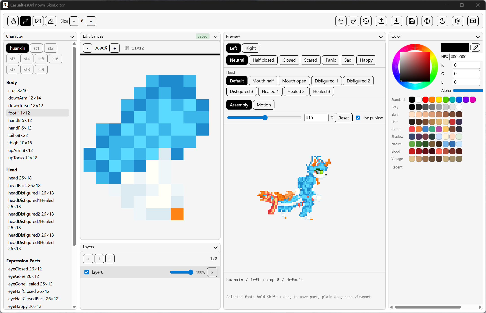

<!-- markdownlint-disable MD033 MD036 MD041 -->

<div align="center">

<p align="center">
  <a href="https://github.com/huanxin886"></a>
</p>

# CasualtiesUnknown-SkinEditor

Standalone pixel editor and live character previewer for `Casualties Unknown` (built for the `SkinSync` mod)

<p>
  
  
  
  
  
  
</p>

<p>
  <a href="README.md"><strong>中文项目说明</strong></a>
  ·
  <a href="docs/en/README.md"><strong>English User Guide</strong></a>
  ·
  <a href="docs/zh/README.md"><strong>中文使用文档</strong></a>
  ·
  <a href="changes.en.md"><strong>Changelog</strong></a>
</p>

<p>
  Community skin repository:
  <a href="https://github.com/Paili-16/Scav-Prototype-The-Characters-Skins"><strong>Scav-Prototype-The-Characters-Skins</strong></a>
</p>

</div>

## Screenshots

<table>
  <tr>
    <td align="center" width="50%">
      
      <br>
      <sub>Chinese UI</sub>
    </td>
    <td align="center" width="50%">
      
      <br>
      <sub>English UI</sub>
    </td>
  </tr>
</table>

---

## Overview

Making a custom skin for `Casualties Unknown` normally means juggling dozens of tiny limb, head, wing, and item PNGs by hand and restarting the game just to check sprite alignment. This tool opens the whole skin folder as an interactive workspace: pick parts on the left, paint pixels or effect zones across layers in the center, and watch the assembled character update live on the right, either in a static pose or frame by frame on top of real gameplay motion captures.

Saved PNGs, zone masks (`<Category>/<part>.zones.png` + `.zones.json`), and JSON configs (`baseSizes.json`, `wings.json`, `accessories.json`, `blood.json`) drop straight into `SkinSync`. Multi-layer work files stay under `layers/` for the editor alone and are excluded when you export a distributable zip.

## Architecture

The Tauri v2 desktop app and the Axum HTTP server compile from a single Rust crate:

```text
                        ┌──────────────────────────────┐
                        │   web/ (TypeScript + Vite)   │
                        │ Canvas / Preview / Palette   │
                        └──────────────┬───────────────┘
                                       │ npm run build -> web/dist/
                                       ▼
                        ┌──────────────────────────────┐
                        │  Embedded via rust-embed     │
                        │  Web bundle + default `exp`  │
                        └──────────────┬───────────────┘
                                       │
                ┌──────────────────────┴──────────────────────┐
                ▼                                             ▼
       ┌─────────────────┐                           ┌─────────────────┐
       │  Tauri Desktop  │                           │ Axum HTTP Server│
       │ (65 IPC cmds)   │                           │ (51 /api/*)     │
       └────────┬────────┘                           └────────┬────────┘
                └──────────────────────┬──────────────────────┘
                                       ▼
                           ┌───────────────────────┐
                           │       apiLayer        │
                           │ Sessions & Compositor │
                           └───────────┬───────────┘
                                       ▼
                  skinLoader / imageOps / layerSidecar / zones /
                  accessories / blood / baseSizes / historyManager
```

All 51 core endpoints are exposed identically over Tauri IPC and HTTP REST. Desktop mode adds 14 native commands for child-window management and DPI-aware cross-window color picking. On the frontend, `apiClient` picks the right transport at runtime.

### Backend Modules (`src-tauri/src/`)

| Module | Purpose |
| --- | --- |
| `apiLayer` | Core service entry, split into static compositing (`composite`), motion playback compositing (`motionComposite`), zone light/particle rendering (`zoneRender`), part CRUD (`partManage`), and layer mutations (`layerOps`), plus `wings.json` I/O |
| `skinLoader` | Scans skin folders, decodes PNGs, and handles `.zip` import/export (`pack`) |
| `imageOps` | Pixel operations: hard brush, soft brush, flood fill, linear gradient, eraser, nearest-neighbor resize, and rotated/flipped blitting (`blit`) |
| `layerSidecar` | Reads and writes multi-layer sidecars (`layers/<Cat>/<part>/manifest.json` + `layerN.png`) |
| `assemblyTable` | Default limb coordinates, z-order, and expression/head variant filters, with optional overrides from `assembly.json` |
| `baseSizes` | Standard part catalog and per-skin logical base dimensions (`baseSizes.json`) so high-res textures fit the character rig at proper scale |
| `accessories` / `blood` / `zones` | Readers and writers for `accessories.json`, `blood.json`, and per-part `<part>.zones.png` / `<part>.zones.json` masks and effects |
| `lib` / `imageStore` | App bootstrap, embedded default `exp` skin extraction, and in-memory pixel store for floating reference image windows |
| `historyManager` | 50-entry ring undo/redo stack grouped per stroke |
| `windowManager` / `dataPaths` | `workspace.json` persistence, path validation, and atomic file writes anchored to the app directory |
| `tauriCommands` / `httpServer` | Tauri IPC handlers and Axum REST handlers |

### Frontend Modules (`web/src/`)

The frontend is a plain TypeScript single-page app without a UI framework. Detached panel windows reuse the same bundle via `?panel=<id>`, and reference image windows load via `?image=<token>`.

| Module | Purpose |
| --- | --- |
| `apiClient` / `runtimeMode` | Typed backend client that routes calls to Tauri IPC or `fetch` |
| `stateStore` | In-memory session store (`index`), zone store (`zonesStore`), theme CSS variables (`theme`), and serialized workspace persistence (`workspacePersist`) |
| `partPanel` | Skin selector, collapsible category tree, part copy/delete menu, and unsaved-edit guard (`partSwitchGuard`) |
| `editorCanvas` | Pixel canvas with accessory controls (`accessoryBar`), worn-slot selector (`slotDropdown`), non-destructive layer transform (`transformPanel`), zone overlay (`zonesOverlay`), resize dialog (`resizeDialog`), and add-part dialog (`addPartDialog`) |
| `layerPanel` | Up to 8 layers per part with cross-part copy/paste; switches to the zone light/particle/animation editor (`zoneEditor`) when the zone brush is active |
| `previewCanvas` | 100×100 composite preview supporting static assembly (Shift+drag to nudge parts) and motion-capture playback |
| `colorPalette` | HSV wheel and SV square, preset groups, 24 custom swatch slots, and cross-window eyedropper |
| `wingDebugPanel` / `bloodPanel` | Optional right-hand panels for tuning the 4 wing pieces and `blood.json` parameters |
| `toolPanel` / `shortcuts` / `settingsPanel` | Main toolbar, global shortcut router, keybinding editor, and auto-save settings |
| `dockHost` / `layoutEngine` / `imageWindow` | Dockable/collapsible panels, child-window detach/reattach, split dividers, and reference image viewer |
| `autoSave` / `closeGuard` / `updateChecker` / `i18n` | Timed auto-save, window-close confirmation, GitHub release checker, and Chinese/English strings |

### Data Layout

Runtime files live next to the executable under `data/` and `captures/`:

```text
<app root>/
├── captures/                       # Motion capture JSONs from MotionRecorder
└── data/
    ├── workspace.json              # Panel sizes, collapse states, theme, shortcuts, swatches
    └── skin/
        ├── assembly.json           # Optional global assembly table override
        └── <skinName>/
            ├── Body/               # Torso, limb, and tail PNGs (+ optional *.zones.png / *.zones.json)
            ├── Head/               # Head variants and eye expression PNGs
            ├── Wings/              # Four wing sprites (wingUL / wingUR / wingDL / wingDR)
            ├── Accessories/        # Wearable and held item PNGs
            ├── Blood/              # Blood particle sprites (BloodParticle.png, etc.)
            ├── baseSizes.json      # Logical base dimensions per part
            ├── wings.json          # Optional wing offset, rotation, and zOrder
            ├── accessories.json    # Optional accessory toggles, offsets, slots, and effects
            ├── blood.json          # Optional bleed particle colors, glow, and sheet animation
            └── layers/             # Editor-only multi-layer sidecars (omitted from zip exports)
```

On first launch, if `data/skin/` has no skin folders, the embedded `exp` skin is unpacked to `data/skin/exp/` and selected automatically. Put the executable in a writable folder so workspace settings and part saves can write to disk.

## Building and Running

### Prerequisites

- Rust `1.75+` (MSVC toolchain on Windows)
- Node.js `18+` with `npm`
- WebView2 Runtime on Windows (preinstalled on Win10 1809+ and Win11); `libwebkit2gtk-4.1-dev`, `libgtk-3-dev`, `libayatana-appindicator3-dev`, and `librsvg2-dev` on Linux; Xcode Command Line Tools on macOS.

### Commands

Install frontend dependencies and build the web bundle once:

```bash
cd web
npm ci
npm run build
cd ..
```

Run the desktop app in development:

```bash
cargo run --manifest-path src-tauri/Cargo.toml --bin CasualtiesUnknown-SkinEditor
```

Run in HTTP server mode (open `http://127.0.0.1:5800` in a browser):

```bash
cargo run --manifest-path src-tauri/Cargo.toml --bin CasualtiesUnknown-SkinEditor -- --http --bind 127.0.0.1 --port 5800
```

You can also configure HTTP mode with `SPE_HTTP=1 SPE_BIND=0.0.0.0 SPE_PORT=5800`. Day-to-day testing focuses on Windows desktop; CI builds portable binaries for `windows-x64`, `windows-arm64`, `linux-x64`, `linux-arm64`, and `macos-arm64`.

### Tests and Release Build

```bash
# TypeScript type check
npm --prefix web run test

# Production web bundle (outputs to web/dist/)
npm --prefix web run build

# Rust unit, property, and integration tests
cargo test --manifest-path src-tauri/Cargo.toml

# Portable desktop release binary (embeds web/dist/ and default `exp` skin)
cargo build --release --manifest-path src-tauri/Cargo.toml --bin CasualtiesUnknown-SkinEditor
```

On Windows, the standalone executable is written to `src-tauri/target/release/CasualtiesUnknown-SkinEditor.exe`.

## Documentation

- [English User Guide](docs/en/README.md): full walkthrough of import/export, tools, layers, zones, blood settings, and shortcuts
- [中文使用文档](docs/zh/README.md): Chinese user guide
- [MotionRecorder Guide](motionRecorder/README.en.md) / [中文](motionRecorder/README.md): in-game BepInEx motion capture plugin
- [Changelog](changes.en.md) / [更新日志](changes.md): version history

## License

MIT
