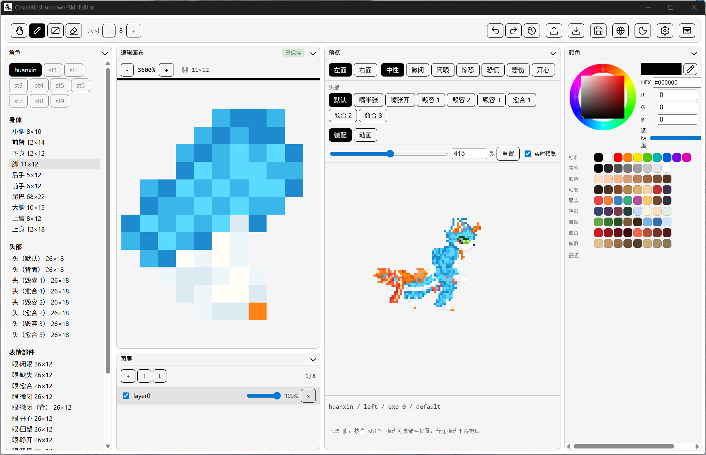
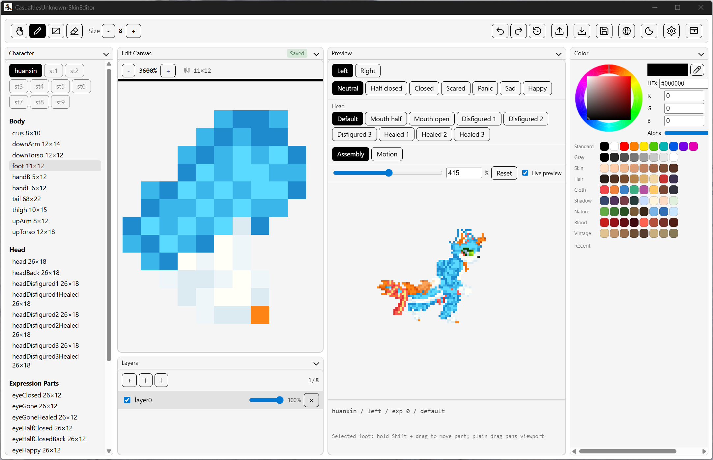

<!-- markdownlint-disable MD033 MD036 MD041 -->

<div align="center">

<p align="center">
  <a href="https://github.com/huanxin886"></a>
</p>

# CasualtiesUnknown-SkinEditor

面向游戏 `Casualties Unknown`（配套 `SkinSync` 模组）的独立皮肤绘制与实时预览工具

<p>
  
  
  
  
  
  
</p>

<p>
  <a href="README.en.md"><strong>English README</strong></a>
  ·
  <a href="docs/zh/README.md"><strong>中文使用文档</strong></a>
  ·
  <a href="docs/en/README.md"><strong>English User Guide</strong></a>
  ·
  <a href="changes.md"><strong>更新日志</strong></a>
</p>

<p>
  社区皮肤仓库：
  <a href="https://github.com/Paili-16/Scav-Prototype-The-Characters-Skins"><strong>Scav-Prototype-The-Characters-Skins</strong></a>
</p>

</div>

## 界面预览

<table>
  <tr>
    <td align="center" width="50%">
      
      <br>
      <sub>中文界面</sub>
    </td>
    <td align="center" width="50%">
      
      <br>
      <sub>English UI</sub>
    </td>
  </tr>
</table>

---

## 这个项目做什么

给 `Casualties Unknown` 做自定义皮肤时，以前得把几十张身体、头部、翅膀、配件贴图拆成零散的 PNG，改几笔就得进游戏看有没有错位。这个工具把整套皮肤目录直接拉进桌面窗口：左边选部件、中间按图层画像素或涂发光/粒子区块、右边实时看角色拼装后的样子，还能直接拿游戏里录下来的真实跑跳动作逐帧回放。

保存出来的 PNG、配件表、翅膀参数和血液粒子配置可以直接交给 `SkinSync` 模组读取，多图层草稿则留在编辑器自己的 `layers/` 目录里，互不干扰。

## 代码结构

桌面版（Tauri v2）和网页服务版（Axum HTTP）编译自同一个 Rust crate：

```text
                        ┌──────────────────────────────┐
                        │   web/ (TypeScript + Vite)   │
                        │  画布 / 预览 / 图层 / 调色盘  │
                        └──────────────┬───────────────┘
                                       │ npm run build -> web/dist/
                                       ▼
                        ┌──────────────────────────────┐
                        │   rust-embed 编译期打入二进制 │
                        │   前端静态资源 + 默认皮肤 exp │
                        └──────────────┬───────────────┘
                                       │
                ┌──────────────────────┴──────────────────────┐
                ▼                                             ▼
       ┌─────────────────┐                           ┌─────────────────┐
       │  Tauri 桌面窗口  │                           │  Axum HTTP 服务  │
       │  (65 条 IPC 命令)│                           │  (51 条 /api/*) │
       └────────┬────────┘                           └────────┬────────┘
                └──────────────────────┬──────────────────────┘
                                       ▼
                           ┌───────────────────────┐
                           │       apiLayer        │
                           │  核心会话与合成渲染层  │
                           └───────────┬───────────┘
                                       ▼
                  skinLoader / imageOps / layerSidecar / zones /
                  accessories / blood / baseSizes / historyManager
```

全部 51 项核心业务接口同时挂载在 Tauri IPC 和 HTTP REST 上，桌面模式额外多出 14 条原生子窗口管理与跨窗口屏幕取色命令。前端通过 `apiClient` 自动按运行环境切换通道。

### 后端模块（`src-tauri/src/`）

| 模块 | 说明 |
| --- | --- |
| `apiLayer` | 业务总入口，拆分了静态合成（`composite`）、动作帧合成（`motionComposite`）、区块光效/粒子渲染（`zoneRender`）、部件增删改（`partManage`）与图层操作（`layerOps`），并负责读写 `wings.json` |
| `skinLoader` | 扫描皮肤目录、读写 PNG、导入与导出 `.zip` 皮肤包（`pack`） |
| `imageOps` | 画笔、柔和笔刷、油漆桶、线性渐变、橡皮、最近邻重采样与带旋转/翻转的像素贴合（`blit`） |
| `layerSidecar` | 多图层工程文件读写（`layers/<分类>/<部件>/manifest.json` + `layerN.png`） |
| `assemblyTable` | 默认肢体装配坐标、层级与表情/头部状态过滤，支持从 `assembly.json` 覆盖 |
| `baseSizes` | 标准部件表与各皮肤部件的基准逻辑尺寸（`baseSizes.json`），让高分辨率贴图按原比例缩回角色骨架 |
| `accessories` / `blood` / `zones` | 分别读写 `accessories.json`、`blood.json` 以及各分类下的 `<部件>.zones.png` / `<部件>.zones.json` 区块掩码与特效配置 |
| `lib` / `imageStore` | 应用引导、编译期内置 `exp` 默认皮肤模板解压与外部参考图子窗口内存池 |
| `historyManager` | 单部件 50 步环形撤销/重做栈，按落笔到抬笔的一整笔合并历史 |
| `windowManager` / `dataPaths` | `workspace.json` 布局与主题持久化，以及相对程序根目录的路径校验与原子写盘 |
| `tauriCommands` / `httpServer` | Tauri IPC 命令层（含 Windows 高 DPI 跨子窗口取色）与 Axum HTTP 路由层 |

### 前端模块（`web/src/`）

前端是原生 TypeScript 写的单页应用，没有引入前端框架。独立面板子窗口通过 `?panel=<id>` 复用同一份打包产物，参考图窗口走 `?image=<token>`。

| 模块 | 说明 |
| --- | --- |
| `apiClient` / `runtimeMode` | 封装后端 DTO 与请求分发，自动识别 Tauri 桌面壳或浏览器环境 |
| `stateStore` | 内存会话状态（`index`）、区块数据仓库（`zonesStore`）、主题变量计算（`theme`）以及单飞串行写盘的工作区缓存（`workspacePersist`） |
| `partPanel` | 左侧皮肤选择与部件树，含新建/复制/删除部件和未保存切换拦截（`partSwitchGuard`） |
| `editorCanvas` | 中央像素画布，拆分了配件栏（`accessoryBar`）、穿戴槽下拉（`slotDropdown`）、图层实时变换（`transformPanel`）、区块叠加层（`zonesOverlay`）、改分辨率弹窗（`resizeDialog`）与新建部件弹窗（`addPartDialog`） |
| `layerPanel` | 底部图层列表与跨部件复制粘贴；切到魔法笔时切换为区块灯光/粒子/帧动画参数面板（`zoneEditor`） |
| `previewCanvas` | 右侧 100×100 合成预览，支持静态装配（Shift+拖动调位）与动作捕捉 JSON 逐帧回放 |
| `colorPalette` | HSV 色相环、明度/饱和度方块、预设色板、24 格自定义色卡及跨窗口吸管 |
| `wingDebugPanel` / `bloodPanel` | 右侧可选展开的 4 片翅膀参数调试面板与血液粒子配置面板 |
| `toolPanel` / `shortcuts` / `settingsPanel` | 顶部工具栏、全局快捷键分发、热键重绑与自动保存参数设置 |
| `dockHost` / `layoutEngine` / `imageWindow` | 面板停靠、折叠、拖出独立子窗口、分栏拖拽与外部参考图查看器 |
| `autoSave` / `closeGuard` / `updateChecker` / `i18n` | 定时自动保存、关闭窗口未保存确认、GitHub 新版检测与中英双语词典 |

### 目录与文件约定

运行期数据默认存放在可执行文件同级的 `data/` 与 `captures/` 目录：

```text
<程序目录>/
├── captures/                       # 动作捕捉 JSON（放 MotionRecorder 录出的 motion_*.json）
└── data/
    ├── workspace.json              # 面板尺寸、折叠态、主题、快捷键与调色盘记录
    └── skin/
        ├── assembly.json           # 全局装配表覆盖（可选，缺省用内置表）
        └── <皮肤名>/
            ├── Body/               # 身体与四肢贴图（含同目录可选的 *.zones.png / *.zones.json）
            ├── Head/               # 头部与眼睛表情贴图
            ├── Wings/              # 4 片翅膀贴图（wingUL / wingUR / wingDL / wingDR）
            ├── Accessories/        # 穿戴与手持配件贴图
            ├── Blood/              # 血液粒子贴图（BloodParticle.png / BloodParticle_splat.png）
            ├── baseSizes.json      # 部件基准尺寸表
            ├── wings.json          # 翅膀偏移、旋转与层级（可选）
            ├── accessories.json    # 配件开关、偏移、穿戴槽与特效配置（可选）
            ├── blood.json          # 血液颜色、寿命、发光与帧动画配置（可选）
            └── layers/             # 编辑器私有多图层工程数据（导出 zip 时自动排除）
```

首次启动时，如果 `data/skin/` 为空，程序会自动把编译期内置的 `exp` 默认皮肤释放到 `data/skin/exp/` 并选中，开箱就能直接画。请把程序放在有写入权限的目录（不要直接塞进受系统保护的 `Program Files`），否则保存和配置落盘会报错。

## 本地开发与构建

### 依赖环境

- Rust `1.75+`（Windows 下使用 MSVC 工具链）
- Node.js `18+`（附带 `npm`）
- Windows 10 1809+ / Windows 11 自带的 WebView2 Runtime；Linux 需安装 `libwebkit2gtk-4.1-dev`、`libgtk-3-dev`、`libayatana-appindicator3-dev`、`librsvg2-dev`；macOS 需安装 Xcode Command Line Tools。

### 构建与运行命令

先安装一次前端依赖并打包静态资源：

```bash
cd web
npm ci
npm run build
cd ..
```

启动桌面窗口（开发调试）：

```bash
cargo run --manifest-path src-tauri/Cargo.toml --bin CasualtiesUnknown-SkinEditor
```

以纯 HTTP 服务方式启动（浏览器打开 `http://127.0.0.1:5800`）：

```bash
cargo run --manifest-path src-tauri/Cargo.toml --bin CasualtiesUnknown-SkinEditor -- --http --bind 127.0.0.1 --port 5800
```

也可以通过环境变量 `SPE_HTTP=1 SPE_BIND=0.0.0.0 SPE_PORT=5800` 启动 HTTP 模式。日常主力测试环境是 Windows 桌面版，Linux 与 macOS 通过 GitHub Actions 交叉构建产物（覆盖 `windows-x64`、`windows-arm64`、`linux-x64`、`linux-arm64`、`macos-arm64` 五个目标）。

### 跑测试与打 Release 包

```bash
# 前端 TypeScript 类型检查
npm --prefix web run test

# 前端生产打包（输出到 web/dist/）
npm --prefix web run build

# Rust 单元测试、属性测试与集成测试
cargo test --manifest-path src-tauri/Cargo.toml

# 编译单文件便携版 Release（前端资源与默认皮肤已内嵌）
cargo build --release --manifest-path src-tauri/Cargo.toml --bin CasualtiesUnknown-SkinEditor
```

Windows 下编译好的单文件位于 `src-tauri/target/release/CasualtiesUnknown-SkinEditor.exe`。

## 相关文档

- [中文使用说明](docs/zh/README.md)：界面操作、工具细节、导入导出格式、区块与血液配置、快捷键
- [English User Guide](docs/en/README.md)：英文版完整使用手册
- [MotionRecorder 说明（中文）](motionRecorder/README.md) / [English](motionRecorder/README.en.md)：游戏内动作录制 BepInEx 插件的编译、按键与 JSON 格式说明
- [更新日志](changes.md) / [Changelog](changes.en.md)：各版本改动记录

## 开源许可

MIT
