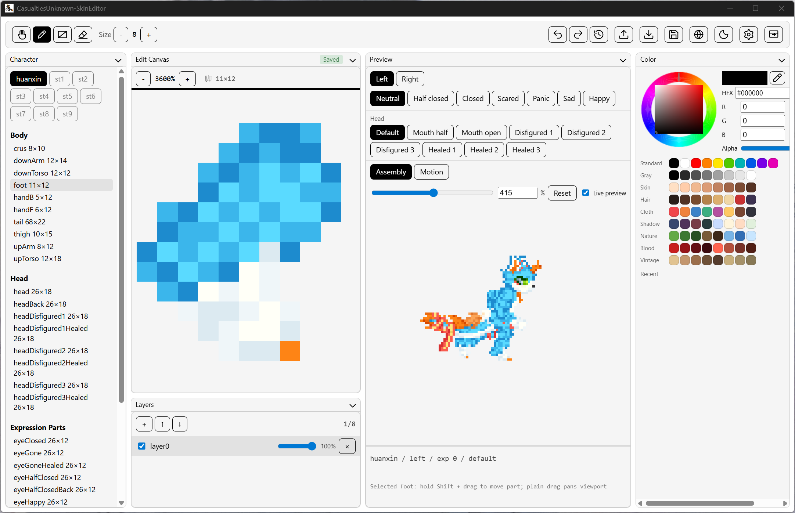
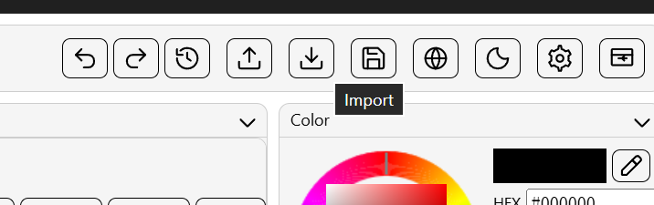
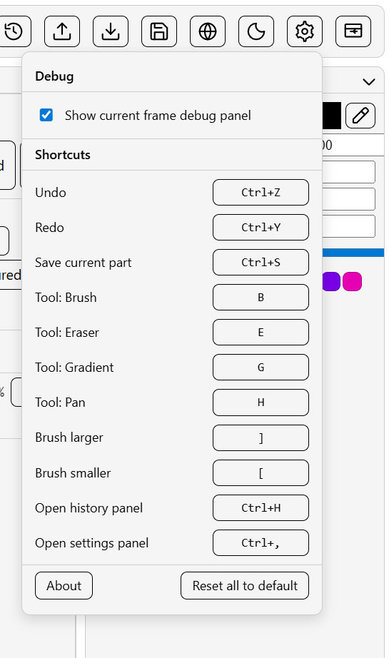

<!-- markdownlint-disable MD033 MD036 MD041 -->

# CasualtiesUnknown-SkinEditor — User Guide

This document focuses on how to use the editor. For build and development details, see the repository [README.md](../../README.md). The repository overview is also available in English at [README.en.md](../../README.en.md).

Current version: **1.0.6** (changes listed in [Changelog](../../changes.en.md)).

---

## 1. Skin Package Layout

The mod `body_sprite_replacer` reads several fixed subdirectories from each skin folder: `Body/`, `Head/`, `Wings/`, `Accessories/`, and `Blood/` for the body, head, wing, accessory, and blood-particle textures respectively. The editor adds a `layers/` directory next to them for multi-layer project data, and supports three optional config files (`wings.json` / `accessories.json` / `blood.json`).

```text
data/
├── workspace.json            # Layout / theme / current skin (auto-created at first launch)
└── skin/
    └── <skinName>/           # One skin = one directory; the directory name is the skin name
        ├── Body/             # Body parts as flat PNG (read by the mod)
        ├── Head/             # Head parts as flat PNG (read by the mod)
        ├── Wings/            # Wing PNG (4 sprites: wingUL/wingUR/wingDL/wingDR)
        ├── Accessories/      # Accessory PNG (autopump.png etc.)
        ├── Blood/            # Blood particle textures (e.g. BloodParticle.png)
        ├── wings.json        # Wing assembly overrides (optional)
        ├── accessories.json  # Accessory enable / position overrides (optional)
        ├── blood.json        # Blood particle config (optional)
        └── layers/           # Editor project files; the mod ignores this folder entirely
            └── <Cat>/<part>/
                ├── manifest.json
                └── layerN.png
```

The mod loads PNGs from `Body/` / `Head/` / `Wings/` / `Accessories/` / `Blood/` and the three optional JSON configs at the skin root. `layers/` is extra project data maintained by the editor to preserve undo state and layer structure; it has no effect on the mod.

## 2. First Launch

Double-click the release exe, or run from a development build. On first launch the editor does two things:

1. Creates `data/workspace.json` next to the exe with the default layout and theme.
2. If `data/skin/` has no skin subdirectories, unpacks the built-in `exp` skin pack to `data/skin/exp/` and selects it automatically.

After launch the window has a top toolbar, a part list on the left, the editor canvas in the middle, a layer strip at the bottom, the composite preview on the right, and the color palette farthest right.



If `data/skin/` already contains skin directories, the skin dropdown at the top-left auto-populates. On a fresh install with an empty folder, the built-in `exp` skin appears automatically so you can start editing right away; you can still import a zip or drop in other skin directories at any time.

## 3. Importing a Skin Pack

### 3.1 Zip layout

The importer accepts either of the following shapes:

```text
Form A (preferred):
my-skin.zip
├── Body/
│   ├── body.png
│   └── ...
└── Head/
    ├── head.png
    └── ...

Form B (one wrapping directory is also accepted):
my-skin.zip
└── arbitrary-name/
    ├── Body/...
    └── Head/...
```

Validation:

- The file extension must be `.png`.
- Paths must not contain `..` or absolute path fragments.

The importer creates a new skin directory using the **zip file name without the `.zip` extension**, landing under `data/skin/<zipName>/`. If the directory already exists, the PNGs inside are overwritten, but the existing `layers/` project files are left untouched.

### 3.2 Doing the import

The import button on the toolbar opens the OS file dialog.



After picking the file you get a toast:

- Green: import succeeded; the count in parentheses is how many parts landed.
- Yellow: import completed but `imported=0`. Usually means the zip layout does not match the rules above.
- Red: import failed. The text is prefixed with `importSkinPack:` followed by the actual error code.

On success the skin dropdown switches to the newly imported skin.


### 3.3 Importing without the UI

If you just want to drop in a few skin folders, copy them into `data/skin/<skinName>/` directly. The skin dropdown picks them up after a refresh or restart. This path skips all validation; non-PNG files in the directory cause no error but are not used either.

### 3.4 Smart import: flat zip

If a zip has no `Body/` / `Head/` subfolders and only flat PNGs, the importer routes each PNG by filename against the standard part table, landing at `<newSkin>/<category>/<filename>.png`:

- Filenames matching Body / Head / Wings / Accessories standard parts go to the matching category folder
- Filenames containing the `blood` keyword go to `Blood/`
- Unmatched PNGs are skipped; the success toast counts only the routed ones

The detection also handles sided copies like `experimentEyeOpenF` / `HandB`, falling back to the base name to look up standard sizes.

## 4. Editing Workflow

### 4.1 Selecting a part

The left panel groups parts by Skin → Category → Part. Categories are split into five groups — **Body / Head / Wings / Accessories / Blood textures** — each independently collapsible; the collapse state is saved to workspace config. Click a part to load its PNG into the central canvas. The canvas title bar shows a saved badge: green for clean, yellow for unsaved.


Part names render through a localization map (e.g. `experimentBody` shows up as "Body", `autopump` as "自动泵" under zh, `BloodParticle` as "血液粒子"). The backend identifier is still the raw file name, so renaming a PNG does not break existing project files but will be treated as a new part.

### 4.2 Toolbar

Toolbar groups, left to right:

| Group | Buttons | Purpose |
| --- | --- | --- |
| Tools | Pan / Brush / Gradient / Eraser | Mouse behavior on the canvas |
| Brush size | Numeric input | Brush and eraser size in pixels (1–64) |
| History | Undo / Redo / History | Per-stroke undo; the history popover is read-only, no jumping |
| Files | Export / Import / Save | Whole-skin export & import + current-part save |
| Settings | Language / Theme / Settings / Reset layout | Language toggle / theme color / shortcut editor / restore default layout |


### 4.3 Pixel editing

- **Brush**: mouse-down starts a stroke, drag to draw, release commits one history entry (not one per pixel).
- **Eraser**: same shape as the brush, but clears to fully transparent.
- **Gradient**: mouse-down picks the start point, drag picks the end point, release applies. The gradient runs from the current color to fully transparent.
- **Pan**: drags the view inside the canvas without touching pixels.

Undo and redo are stroke-grouped, so continuous painting does not blow up the undo stack. The history is a 50-entry ring; older entries are dropped once the limit is hit.

### 4.4 Layers

The bottom strip shows up to 8 layers for the current part. Each layer can:

- Toggle visibility (eye icon)
- Adjust opacity (0–100% slider)
- Reorder by drag
- Delete (deleting the last remaining layer is rejected)

New layers land on top of the active layer. Saving the part writes layer data to `layers/<Cat>/<part>/manifest.json` and one `layerN.png` per layer.


### 4.5 Color palette

The right-most palette offers:

- HSV color wheel with a value slider (hue ring 28px wide, SV box 96px)
- Current color preview and an eyedropper button (PS-style picker)
- 12 most-recent colors (FIFO)
- Custom swatches: 3 rows × 8 = 24 user slots

The eyedropper supports two interaction modes:

- **Click-pick**: a single click on the editor canvas, composite preview, or any drag-in image window commits the color under the cursor into "recent".
- **Drag-pick**: hold the left mouse button after activating the dropper for a live preview as the cursor moves; release to commit into "recent".
- Press Esc at any time to cancel and restore the previous color.

Custom swatches:

- Click an empty slot → fills it with the current color
- Click a filled slot → switches to that color
- **Long-press 600ms** or **right-click** any slot → opens an inline editor (HEX input / use current color / clear)
- All 24 slots persist to workspace config across sessions


### 4.6 Composite preview

The right preview area has two modes:

- **Assembly**: composes every visible part of the current skin from the assembly table, in z-order
- **Motion**: reads MotionRecorder JSON files from `captures/` and composites the skin frame by frame

The first time you switch to motion mode, the editor automatically creates the `captures/` directory next to the AppRoot if it does not exist (v1.0.7+); drop the `motion_*.json` produced by MotionRecorder into that folder and hit refresh.

Those JSON files are not recorded by the editor itself. They come from the in-game BepInEx mod MotionRecorder. Installation and field details are documented in [motionRecorder/README.en.md](../../motionRecorder/README.en.md).

Assembly mode has live preview on by default, so every committed stroke triggers a new composite. If performance is poor, turn off live preview and use the refresh button instead. Motion mode uses the same toggle: when live preview is enabled, the current frame also picks up unsaved in-memory layer edits immediately; when it is off, the frame stays stale until you hit the refresh button.

In motion mode the toolbar grows a small capture control group:

- a capture picker listing the JSON files under `captures/`
- a play / pause button
- a frame slider for jumping to any frame directly

While playback is running, the preview advances along the capture timeline. When paused, you can inspect a single frame against the real pose data. The "Current frame limbs" panel on the right lists each limb's name, coordinates, rotation, and z-order for the active frame; the panel itself can be hidden from settings, and the bottom preview info area can be resized by dragging its divider.

Expression, head variant, and facing controls stay active in motion mode. Changing them immediately re-composites the current captured frame, which makes it practical to compare different heads and eye states against the same recorded motion.

Switching skins ignores the live-preview toggle and forces one refresh, to avoid mismatched visuals.

### 4.7 Blood particle editor panel

Blood particles are an independent mod subsystem for hit and bleed effects. They live as a `<skinName>/blood.json` config plus a `<skinName>/Blood/BloodParticle.png` texture. The editor wires both paths to two separate entry points:

- **Texture editing**: open the "Blood textures" group in the part panel and click `BloodParticle`. It edits like any other part — pixels, resize, multi-layer, undo/redo.
- **Parameter editing**: the blood particle button on the toolbar opens the right-side blood panel, which visually edits all 14 fields of `blood.json`.

Fields covered by the blood panel:

| Group | Fields |
| --- | --- |
| Particle color | Start color / End color |
| Particle size | Start size / End size |
| Lifetime / Alpha | Particle lifetime, Alpha start / end curve |
| Limb wound colors | Dark color / Light color (used by limb-bound wound effects) |
| Glow | Additive toggle and intensity |
| Sprite-sheet animation | Rows / Columns / Frame duration |
| Random palette | Color list (add / remove / edit) |

Every field has an **override tri-state toggle** on its left:

- Off: use the mod default (do not write to `blood.json`)
- On: use the value set in the panel (write to `blood.json`)
- Mid: leave the existing value in `blood.json` untouched

Switching the active skin reloads values; edits are auto-saved with a 300ms debounce, no manual save needed. Deleting `blood.json` does not break the game — the mod falls back to defaults.

## 5. Saving and Exporting

### 5.1 Saving the current part

The save button on the toolbar writes two things:

1. The flattened composite to `<skinName>/{Body|Head}/<part>.png` (this is what the mod reads)
2. The multi-layer project data to `<skinName>/layers/<Cat>/<part>/manifest.json` plus one `layerN.png` per layer

If a write fails (most often because the disk is read-only or permissions are missing), a red toast surfaces the error and the unsaved badge stays. Hitting save again retries. Failures while writing the `layers/` sidecar are logged to stderr but never block the main PNG from landing.

A part with unsaved changes shows a yellow badge in the title bar. Closing the main window while any part is unsaved triggers a confirmation dialog:

- **Save and exit**: bulk-saves every unsaved part, then exits
- **Don't save**: exits immediately, dropping changes
- **Cancel**: stays in the program

### 5.2 Exporting the whole skin

The export button packages the current skin into a zip. Clicking it first opens an inline modal to pick the export format and whether to include the blood config:

| Option | What you get |
| --- | --- |
| **Legacy** | `<skinName>/Body/` flat with all parts in one folder (compatible with older mod versions) |
| **Categorized** | `<skinName>/{Body, Head, Wings, Accessories}/` (recommended; aligned with the 1.0.2 mod) |
| **Include blood** | When checked, also packs `blood.json` and `Blood/*.png` |

After confirming the format, the OS save dialog opens for the destination. Both formats wrap the output under a `<skinName>/` top-level directory:

```text
<skinName>.zip
└── <skinName>/
    ├── Body/...
    ├── Head/...
    ├── Wings/...        # categorized only
    ├── Accessories/...  # categorized only
    ├── Blood/...        # only when "Include blood" is checked
    ├── wings.json       # categorized + present
    ├── accessories.json # categorized + present
    └── blood.json       # only when "Include blood" + present
```

Export contains **only the flat PNGs and JSON the mod needs**; `layers/` project data is intentionally left out. The cost is that re-importing the export on another machine loses layer history; the benefit is that you can hand the zip directly to mod users without post-processing.

If you need to migrate project files too, copy the entire `data/skin/<skinName>/` directory by hand.

### 5.3 Switching the data root

By default the editor treats `data/` next to the exe as the data root. To point it elsewhere (for example, edit the skin folder inside the mod install), change the skin path from the settings panel — the change is persisted to `workspace.json` and survives restarts.

Switching the path does not migrate in-flight edits; any unsaved part is dropped.

## 6. Shortcuts

The defaults below can all be rebound from the settings panel.

| Action | Default |
| --- | --- |
| Undo | Ctrl+Z |
| Redo | Ctrl+Y / Ctrl+Shift+Z |
| Save current part | Ctrl+S |
| Tool: Pan | H |
| Tool: Brush | B |
| Tool: Gradient | G |
| Tool: Eraser | E |
| Brush size +1 | ] |
| Brush size -1 | [ |

Global shortcuts step aside automatically while focus is in any text input (`input`, `textarea`, `contenteditable`), so they will not interfere with typing.

In the settings panel, click a row's key cell to record a new binding. Per-row reset and full reset are both supported.



## 7. Troubleshooting

| Symptom | Likely cause | What to try |
| --- | --- | --- |
| Window opens to a blank dark page | Windows is in dark mode and WebView2 paints the empty background black | The frontend pins `color-scheme: light`; if it still happens, reinstall the WebView2 Runtime |
| Part list is empty | `data/skin/` has no skin directories and auto-seeding `exp` failed (common cause: no write permission next to the exe) | Ensure the exe folder is writable and restart; or copy a skin directory into `data/skin/`, or import a zip |
| Import shows `imported=0` | The zip has no `Body/` or `Head/` folder inside | Re-check the layout against the rules in section 3.1 |
| Saved a part but the mod still shows the old texture | The mod caches textures during play | Restart the game, or use whatever hot-reload path the mod exposes |
| Eyedropper does nothing in a drag-in image window | The dropper is off, or the window is not part of this app | The dropper only works inside this app's webviews; cross-process screen picking is not supported |
| Save dialog keeps coming back when closing | At least one part is still marked unsaved | Pick "Save and exit" or "Don't save"; "Cancel" keeps you in the app |

For anything not listed, the red toast usually starts with the API name (for example `importSkinPack:` or `savePart:`). Use that prefix when filing a GitHub issue.

## 8. References

- Repository overview, build commands, and module list: [Root README](../../README.md)
