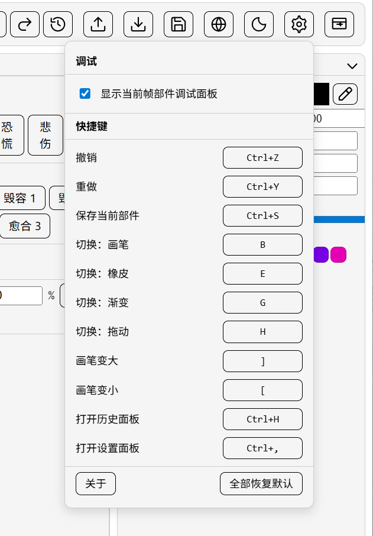

<!-- markdownlint-disable MD033 MD036 MD041 -->

# CasualtiesUnknown-SkinEditor 使用文档

该文档主要用来说明如何使用。开发与构建说明见仓库根目录 [README.md](../../README.md)。

当前版本：**1.0.6**（更新内容见 [更新日志](../../changes.md)）。

---

## 一、皮肤包结构

mod `body_sprite_replacer` 加载的皮肤目录由若干固定子目录组成：`Body/` / `Head/` / `Wings/` / `Accessories/` / `Blood/`，分别存放身体、头部、翅膀、配件 PNG 与血液粒子贴图。编辑器在此基础上增加一份自管的 `layers/` 工程目录用于保留多图层信息，并支持 `wings.json` / `accessories.json` / `blood.json` 三份配置文件。

```text
data/
├── workspace.json            # 布局 / 主题 / 当前皮肤名（启动时自动创建）
└── skin/
    └── <皮肤名>/             # 一个皮肤就是一个目录，目录名即皮肤名
        ├── Body/             # 身体部件 PNG（mod 直接读这里）
        ├── Head/             # 头部部件 PNG（mod 直接读这里）
        ├── Wings/            # 翅膀 PNG（4 张：wingUL/wingUR/wingDL/wingDR）
        ├── Accessories/      # 配件 PNG（autopump.png 等）
        ├── Blood/            # 血液粒子贴图（如 BloodParticle.png）
        ├── wings.json        # 翼装配位置覆盖（可选）
        ├── accessories.json  # 配件启用与位置覆盖（可选）
        ├── blood.json        # 血液粒子配置（可选）
        └── layers/           # 编辑器工程文件（mod 不读，删除不影响游戏）
            └── <Cat>/<部件>/
                ├── manifest.json
                └── layerN.png
```

mod 加载时只关心 `Body/` / `Head/` / `Wings/` / `Accessories/` / `Blood/` 下的 PNG 与三份根目录的 JSON 配置。`layers/` 是编辑器为了保留撤销 / 图层结构额外维护的工程文件，不会被 mod 加载。

## 二、首次启动

在 release exe 所在目录或开发模式下双击启动。首次启动会做两件事：

1. 在 exe 同目录下创建 `data/workspace.json`，写入默认布局与主题
2. 如果 `data/skin/` 下没有任何皮肤子目录，把编译期内置的 `exp` 皮肤包展开到 `data/skin/exp/` 并自动选中

启动后界面如下，自上而下分别是工具栏、左侧部件列表、中央编辑画布、底部图层栏、右侧合成预览、最右调色盘。

[主窗口]
      <br>

如果你的 `data/skin/` 已经放过皮肤目录，启动后左上角"皮肤"下拉会自动列出全部皮肤名。全新安装且目录为空时，会自动出现内置的 `exp` 皮肤，可直接开始编辑；也可随时导入 zip 或手动放入其它皮肤目录。

## 三、导入皮肤压缩包

### 3.1 压缩包规范

编辑器接受的 zip 必须满足下面任一形态：

```text
形态 A（推荐）：
my-skin.zip
├── Body/
│   ├── body.png
│   └── ...
└── Head/
    ├── head.png
    └── ...

形态 B（带一层包装目录也可）：
my-skin.zip
└── 任意名字/
    ├── Body/...
    └── Head/...
```

校验：

- 文件扩展名必须是 `.png`
- 路径不允许包含 `..` 或绝对路径片段

导入时会以**压缩包文件名（去掉 `.zip` 后缀）**作为新皮肤名建目录，落到 `data/skin/<zip 名>/`。重名会覆盖同名目录里的 PNG，但不会清掉里面已有的 `layers/` 文件。

### 3.2 导入操作

工具栏右侧的导入按钮即入口。点击后会弹出系统文件对话框选择 zip。


选完文件后会弹 toast：

- 绿色 toast：导入成功，下方括号里是落地的部件数量
- 黄色 toast：导入完成但 `imported=0`，通常是 zip 内部目录结构不合规
- 红色 toast：导入失败，文字会带 `importSkinPack:` 前缀和具体错误码

成功后皮肤下拉会自动切到新导入的皮肤名。

### 3.3 不通过 UI 导入

如果你只是想批量放几个皮肤，直接把整个皮肤目录拷到 `data/skin/<皮肤名>/` 也可以——刷新或重启后皮肤下拉会自动列出。这条路径不走任何校验，目录里有非 PNG 文件不会报错但也不会被使用。

### 3.4 智能导入：散装 zip

如果 zip 里没有 `Body/` / `Head/` 等分类目录、只是一堆 PNG 平铺，导入器会按 PNG 文件名匹配标准部件表自动归类，落到 `<新皮肤>/<分类>/<文件名>.png`：

- 文件名命中 Body / Head / Wings / Accessories 标准部件 → 进对应分类目录
- 文件名包含 `blood` 关键字 → 进 `Blood/`
- 命中不到的 PNG 会被跳过，toast 用括号给出实际归类的数量

这套机制也会识别 `experimentEyeOpenF` / `HandB` 这类 F/B 后缀的 sided 副本，自动回查 base 名命中标准尺寸表。

## 四、编辑流程

### 4.1 选中部件

左侧部件列表按"角色 / 类别 / 部件"三级展示。类别分为 **Body / Head / Wings / Accessories / 血液贴图** 五组，每组可独立折叠/展开，状态会保存进工作区配置。点中一个部件后，中央编辑画布加载该部件的 PNG，标题栏右侧出现已保存徽标（绿色已保存 / 黄色未保存）。

部件文件名显示为可读中文（例如 `experimentBody` 显示为"身体"、`autopump` 显示为"自动泵"、`BloodParticle` 显示为"血液粒子"）。后端使用的稳定 ID 仍是原始文件名，重命名 PNG 不会让现有工程文件失效，但会被识别成"新部件"。

### 4.2 工具栏

工具栏从左到右分组：

| 分组 | 按钮 | 作用 |
| --- | --- | --- |
| 工具 | 拖动 / 画笔 / 渐变 / 橡皮 | 当前画布的鼠标行为 |
| 笔刷 | 数字输入框 | 画笔与橡皮的像素尺寸（1~64） |
| 历史 | 撤销 / 重做 / 历史 | 撤销重做按笔分组；历史 popover 仅展示，不可跳跃 |
| 文件 | 导出 / 导入 / 保存 | 当前皮肤的整包导出导入 + 当前部件保存 |
| 设置 | 语言 / 主题 / 设置 / 重置布局 | 语言切换 / 主题色 / 快捷键编辑 / 还原默认布局 |


### 4.3 像素编辑

- **画笔**：左键按下开始一笔，移动连续绘制，松开提交一条历史（不是每像素一条）
- **橡皮**：与画笔同形态，把笔触清成全透明
- **渐变**：按下定起点、移动定终点、松开应用；从当前色到全透明
- **拖动**：在画布内拖动视图，不影响像素

### 4.4 图层

底部图层栏列出当前部件的所有图层，最多 8 层。每层可单独：

- 切换可见性（小眼睛图标）
- 调整不透明度（0–100% 滑块）
- 拖动改变层叠顺序
- 删除（删到最后一层会被拒绝）

新增图层会落到当前层之上。所有图层信息会在保存时写入 `layers/<Cat>/<部件>/manifest.json` 与 `layerN.png`。

### 4.5 调色盘

最右侧调色盘提供：

- HSV 色环 + 明度滑块（色相环宽 28px、SV 方块 96px）
- 当前色预览 + 取色针按钮（PS 风格滴管）
- 最近使用色 12 格（FIFO）
- 自定义色卡 3 排 × 8 = 24 个槽位

取色针激活后鼠标变成滴管，支持两种取色：

- **单击取色**：在编辑画布、合成预览、拖入打开的图片子窗口里点一下即把光标处颜色入"最近使用"
- **拖动取色**：按下左键不松开，移动期间持续预览光标处颜色，松开即确认入"最近使用"
- 任意时刻按 Esc 取消并恢复原色

自定义色卡的操作：

- 单击空槽 → 把当前色填入
- 单击已有色槽 → 切换到该颜色
- **长按 600ms** 或 **右键** 任一槽位 → 打开 inline 编辑器（HEX 输入 / 使用当前色 / 清空）
- 24 个槽位会保存到工作区配置，跨会话保留


### 4.6 合成预览

右侧预览区有两种模式：

- **装配**：按装配表合成当前皮肤所有可见部件（按 z-order）
- **动画**：直接读取 MotionRecorder 写出的 `captures/` JSON，按帧合成当前皮肤

第一次切到动画模式时，编辑器若发现 `captures/` 目录不存在会自动按 AppRoot 解析并占位创建（v1.0.7+），把 MotionRecorder 生成的 `motion_*.json` 复制进去再点刷新即可。

这些 JSON 不是编辑器自己录的，而是游戏内的 BepInEx mod MotionRecorder 录出来的。。安装和字段说明见 [`motionRecorder/README.md`](../../motionRecorder/README.md)。

装配模式默认开启实时预览，每次画完一笔就会重新合成；如果卡顿，可以关闭"实时预览"，改用旁边的刷新按钮手动合成。动画模式沿用同一套开关：开启时，当前部件即使还没保存到磁盘，也会直接拿编辑器里的未保存图层参与当前帧合成；关掉后会进入待刷新状态，点刷新按钮再更新当前帧。

动画模式下，预览工具栏会多出一组动作捕捉控件：

- 左侧是动作文件选择器，列出 `captures/` 目录里的 JSON
- 中间是播放 / 暂停按钮
- 右侧是当前帧滑杆，可直接拖到任意一帧

播放时预览会按捕捉时间轴推进；暂停后可以停在单帧上对照部件位置。右侧"当前帧部件"面板会列出这一帧的 limb 名、坐标、旋转与 z-order，面板本身可以在设置里隐藏；底部的预览说明区也可以通过分隔线拖动高度。

动画模式里的表情和头部按钮不只是查看用。切换表情、头部变体、朝向后，当前帧会立刻按新的组合重新合成，因此可以直接拿真实动作去看不同头部和眼神在运动中的效果。

切换皮肤时无视实时预览开关强制刷新一次，避免视觉错位。

### 4.7 血液粒子编辑面板

血液粒子是 mod 用来渲染受击 / 流血效果的独立子系统，包含一份 `<皮肤名>/blood.json` 配置 + 一张 `<皮肤名>/Blood/BloodParticle.png` 贴图。编辑器把这两条路径分别接到两个入口：

- **贴图编辑**：在左侧"血液贴图"分组里点 `BloodParticle`，与普通部件一样在画布里画像素 / 改分辨率 / 多图层 / 撤销重做。
- **参数编辑**：工具栏血液粒子按钮打开右侧血液粒子面板，可视化编辑 `blood.json` 全部 14 个字段。

血液粒子面板覆盖的字段：

| 字段组 | 字段 |
| --- | --- |
| 粒子颜色 | 起始颜色 / 结束颜色 |
| 粒子尺寸 | 起始尺寸 / 结束尺寸 |
| 寿命 / Alpha | 粒子寿命、Alpha 起 / 终曲线 |
| Limb 血色 | 暗血色 / 亮血色（用于 limb 绑定的伤口效果） |
| 发光 | Additive 开关与强度 |
| 帧动画 | sprite-sheet 行 / 列 / 帧时长 |
| 随机配色 | 颜色列表（增删改） |

每个字段左侧都有 **override 三态切换**：

- 关：使用 mod 默认值（不写进 `blood.json`）
- 开：使用面板里设置的值（写进 `blood.json`）
- 中态：保持现有 json 中的值不动

切换皮肤会重新拉一次值；改值会按 300ms debounce 自动写盘，无需手动保存。删除 `blood.json` 不影响游戏，mod 端会回退默认值。

## 五、保存与导出

### 5.1 保存当前部件

工具栏的保存按钮把当前部件写盘：

1. 把合成结果写到 `<皮肤名>/{Body|Head}/<部件>.png`（mod 直接读这里）
2. 把多图层工程数据写到 `<皮肤名>/layers/<Cat>/<部件>/manifest.json` + `layerN.png`

如果某个保存路径写失败（最常见是磁盘只读或目录权限不足），UI 会以红色 toast 报错并保留未保存徽标，下次再点保存会重试。`layers/` 写失败时仅 stderr 警告，不会阻塞主产物落地。

未保存的部件在标题栏会显示黄色徽标。关闭主窗口时如果还有任何部件处于未保存状态，会弹出确认对话框：

- **保存并退出**：批量保存全部未保存部件后退出
- **不保存**：直接退出，丢弃改动
- **取消**：留在程序内

### 5.2 导出整包

工具栏导出按钮把当前皮肤打成 zip。点击后会先弹一个 inline modal 选择导出格式与是否附带血液配置：

| 选项 | 内容 |
| --- | --- |
| **旧式** | `<皮肤名>/Body/` 平铺所有部件（旧版 mod 兼容） |
| **新式** | `<皮肤名>/{Body, Head, Wings, Accessories}/` 分类（推荐，与 1.0.2 mod 对齐） |
| **包含血液配置** | 勾选后额外打包 `blood.json` + `Blood/*.png` |

确认格式后再弹系统保存对话框选 zip 落盘位置。两种格式产物都套 `<皮肤名>/` 顶层前缀：

```text
<皮肤名>.zip
└── <皮肤名>/
    ├── Body/...
    ├── Head/...
    ├── Wings/...        # 仅新式
    ├── Accessories/...  # 仅新式
    ├── Blood/...        # 仅勾选"包含血液配置"
    ├── wings.json       # 仅新式且存在
    ├── accessories.json # 仅新式且存在
    └── blood.json       # 仅勾选"包含血液配置"且存在
```

导出**只打 mod 需要的 PNG 与 JSON**，不会带上 `layers/` 工程文件。

如果你需要连工程文件一起搬迁，直接拷贝 `data/skin/<皮肤名>/` 整个目录即可。

### 5.3 切换数据根目录

启动后默认把 exe 所在目录的 `data/` 当作数据根。如果你要切到其他位置（例如直接编辑 mod 安装位置下的皮肤目录），可以在设置面板修改 skin 路径——这条改动会写进 `workspace.json`，下次启动延续。

注意切换路径不会迁移已有改动，未保存的部件会被丢弃。

## 六、快捷键

下面是默认快捷键，全部都可以在设置面板里改。

| 动作 | 默认键 |
| --- | --- |
| 撤销 | Ctrl+Z |
| 重做 | Ctrl+Y / Ctrl+Shift+Z |
| 保存当前部件 | Ctrl+S |
| 切换工具：拖动 | H |
| 切换工具：画笔 | B |
| 切换工具：渐变 | G |
| 切换工具：橡皮 | E |
| 笔刷尺寸 +1 | ] |
| 笔刷尺寸 -1 | [ |

进入任意输入框（`input` / `textarea` / `contenteditable`）时全局快捷键会自动让位，不会和文字输入冲突。

设置面板里点击单元格录制新键，单行恢复默认或全部恢复默认都支持。



## 七、故障排查

| 现象 | 可能原因 | 应对 |
| --- | --- | --- |
| 启动后界面是空白深色页 | Windows 处于系统暗色模式，且 WebView2 误把空背景渲成黑 | 已在前端固定 `color-scheme: light`，如果仍出现请重装 WebView2 Runtime |
| 部件列表为空 | `data/skin/` 下没有任何皮肤目录，且自动播种 `exp` 失败（常见原因：exe 目录无写权限） | 确认 exe 旁有写权限后重启；或手动把皮肤目录拷到 `data/skin/`，或用导入按钮拖 zip 进来 |
| 导入提示 `imported=0` | zip 内部没有 `Body/` 或 `Head/` 子目录 | 检查 zip 结构是否符合"皮肤包规范"小节 |
| 保存后 mod 仍然加载旧贴图 | mod 在游戏运行时缓存贴图 | 重启游戏，或在 mod 提供的方式里触发热重载 |
| 取色针在图片子窗口不工作 | 取色针未激活、或子窗口不属于本程序 | 取色针只在本程序的 webview 内有效，跨进程屏幕取色不支持 |
| 关闭程序时一直弹保存对话框 | 有部件处于"未保存"状态 | 选"保存并退出"或"不保存"；点"取消"会留在程序内 |

如果遇到上面没列的错误，红色 toast 文本里通常带 API 名称前缀（例如 `importSkinPack:`、`savePart:`），请截图并且复制错误信息提交到github issue。

## 八、参考

- 仓库说明、构建命令、模块清单：[根目录 README](../../README.md)
